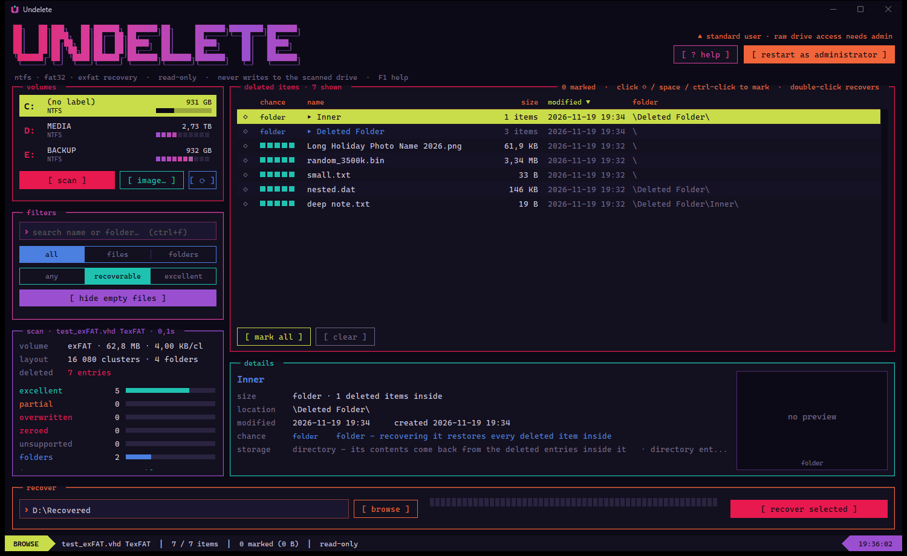
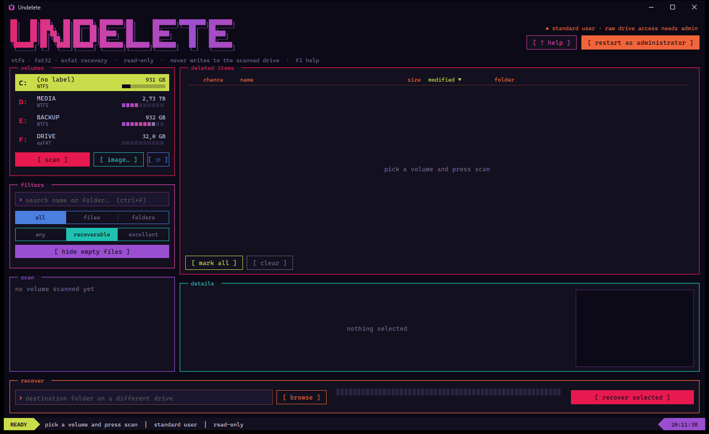
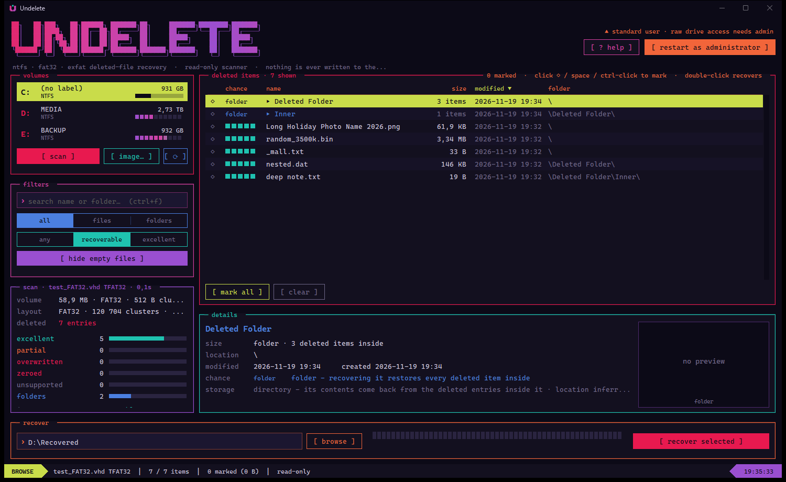
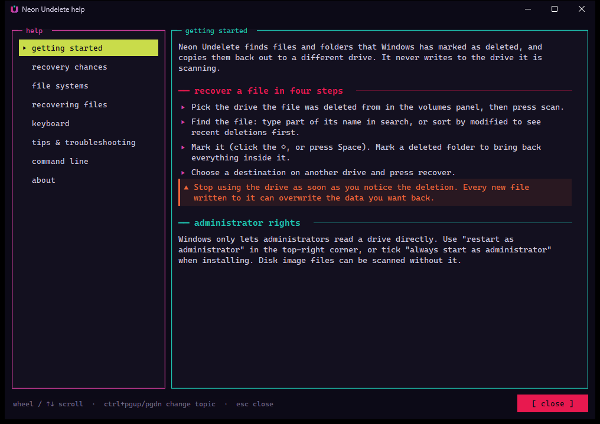
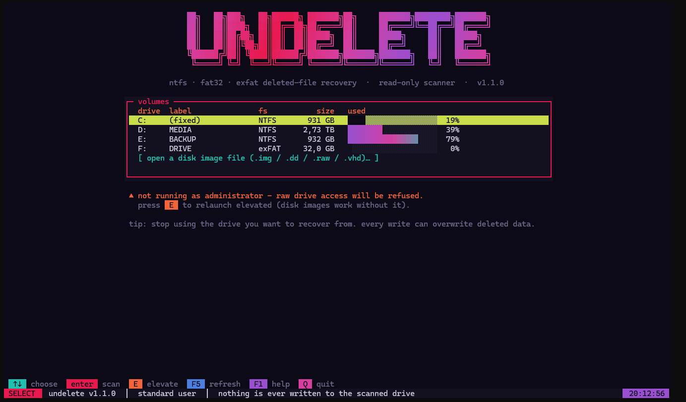

# Neon Undelete

Recovers deleted files and folders from **NTFS, FAT32/FAT16/FAT12 and exFAT** drives: PC disks, USB sticks, SD cards and camera cards. It reads the drive's file table directly, finds the entries marked as deleted, rebuilds where each one used to live, and copies the data out to a **different** drive.



## Download

Get **`NeonUndelete-Setup.exe`** from the [latest release](../../releases/latest) and run it. It installs for your user only, with no admin needed. Windows SmartScreen may warn about an unsigned installer: choose **More info → Run anyway**.

## Screenshots

| | |
|---|---|
|  |  |
| Start screen: pick a drive | FAT32 scan: long names and deleted folders rebuilt |
|  |  |
| Built-in help (F1) | Terminal version (`undelete`) |

| File system | How deleted files are found | How exact the recovery is |
|---|---|---|
| NTFS | freed records in the Master File Table | exact: every fragment's location is kept |
| exFAT | directory entry sets with the in-use bit cleared | exact for contiguous files; others follow what's left of the FAT chain |
| FAT32/16/12 | directory entries starting with 0xE5; long names reattached by checksum | assumes each file is contiguous, because FAT erases the chain. The first letter of names with no long version becomes `_` |

Press **F1** (or click **? help**) for built-in help covering every step, rating and shortcut. `UndeleteGui.exe --help` opens the help directly.

It comes as two programs built from the same engine, using the C# compiler that ships with Windows. No SDK or runtime install is needed.

- **`UndeleteGui.exe`**: the windowed app (recommended)
- **`Undelete.exe`**: the terminal UI, plus command-line options for scripting

## Windowed app

Double-click `UndeleteGui.exe`. If it isn't running as Administrator, click **restart as administrator** (top right). Disk image files work without admin.

- **Volumes:** pick a drive and press **scan**. Double-clicking a drive also scans it. **image…** opens a raw disk image file.
- **Filters:** live search (Ctrl+F), all / files / folders, recovery-chance filter, and hide empty files.
- **Scan:** shows live progress with a throughput sparkline. Afterwards it shows a breakdown by recovery chance and how much data is intact.
- **Deleted items:** click a column header to sort. Mark items by clicking ◇, with Space, or with Ctrl-click; Shift-click marks a range and Ctrl+A marks everything shown. Double-click or Enter recovers the current item.
- **Details and preview:** full path, dates, and recovery chance with an explanation. The preview pane shows an **image thumbnail** (jpg / png / gif / bmp / tiff), a text excerpt or a hex dump, read straight from the deleted file's clusters.
- **Recover:** choose a destination on another drive and press **recover**. A progress meter runs while it works, then a summary appears with an **open folder** button.

## Install

Run **`dist\NeonUndelete-Setup.exe`**. It installs for your user only, with no admin needed, into `%LOCALAPPDATA%\Programs\Neon Undelete` and adds:

- a Start menu shortcut (and optionally a desktop one) with the Neon Undelete icon
- an entry under **Settings → Apps → Installed apps**, where you can uninstall it
- optionally: "always start as administrator", and the `undelete` command on your PATH

Running setup again updates an existing install. For scripting there's `NeonUndelete-Setup.exe /silent [/desktop] [/admin] [/path]`, and `uninstall.exe /uninstall /silent` removes it.

## Build

```powershell
.\build.ps1      # builds Undelete.exe, UndeleteGui.exe and dist\NeonUndelete-Setup.exe
```

## Microsoft Store package (Neon Undelete)

```powershell
.\tools\make-assets.ps1      # regenerate icons/tiles (already done)
.\packaging\package.ps1      # builds packaging\out\NeonUndelete_<version>_x64.msix
```

The package needs Microsoft's MSIX tools, which aren't in this repository. Fetch them once from the official NuGet package:

```powershell
New-Item -ItemType Directory -Force tools\sdk-buildtools | Out-Null
Invoke-WebRequest https://www.nuget.org/api/v2/package/Microsoft.Windows.SDK.BuildTools -OutFile tools\sdk-buildtools\buildtools.zip
Expand-Archive tools\sdk-buildtools\buildtools.zip tools\sdk-buildtools\pkg
```

 `packaging\STORE-LISTING.md` has the Partner Center steps, the listing text, the capability justifications and test instructions. `packaging\PRIVACY.md` is the privacy policy to host.

## Terminal UI

Run `Undelete.exe` in Windows Terminal (any console with 24-bit colour works). Raw drive access needs Administrator rights: press **E** on the drive screen to relaunch elevated. Raw disk image files (`.img` / `.dd` / `.raw`) work without admin.

1. **Pick a volume**: shows the NTFS drives, plus an option to open an image file.
2. **Scan**: reads the whole MFT. On a 3 TB drive with 770k records this takes about 11 seconds.
3. **Browse** deleted items, then mark them and recover:

| key | action |
|---|---|
| ↑ ↓ PgUp PgDn Home End | move |
| Space / A / X | mark item / mark all shown / clear marks |
| `/` | live search on name + path |
| T | type filter: all, files, folders |
| C | chance filter: any, recoverable, excellent |
| S / I | cycle sort (modified, name, size, chance, folder) / reverse the order |
| Z | show or hide 0-byte files |
| R / Enter | recover marked items (or the current one) |
| Esc / Q | back to drives / quit |

Recovering a deleted **folder** also recovers every deleted item inside it. The output keeps the original folder structure under `<dest>\Undeleted_<drive>_<timestamp>\`, and items whose parent chain was lost go into `_lost_parent_folder\`. Original timestamps are restored.

### Recovery chance

| meter | meaning |
|---|---|
| `■■■■■` teal | **excellent**: none of the file's clusters have been reused |
| `■■□□□` orange | **partial**: some clusters now belong to other files, so expect corruption |
| `□□□□□` red | **overwritten**: all of its space has been reused |
| `zeros` | the space reads back as zeros, typical of a TRIM'd SSD. The content is gone |
| `n/a` | NTFS-compressed or EFS-encrypted (not supported yet) |

### Scripting

```
Undelete.exe --list D: deleted.csv
Undelete.exe --recover D: E:\Recovered "\Users\me\Documents\report"
```

## Safety

- The scanned drive is opened **read-only**. Nothing is ever written to it.
- The tool refuses to recover onto the drive being scanned.
- **Stop using the drive as soon as you notice a deletion.** NTFS reuses freed MFT records quickly: in testing, a busy drive reused freed records within about a minute.
- NTFS writes deletions to disk lazily, so a file deleted only seconds ago may not show up yet. Rescan after about 20 seconds.
- Files in the Recycle Bin are not "deleted" in NTFS terms. Restore those from the Recycle Bin.
- Some volumes refuse direct raw reads (Win32 error 50, usually because of a filter driver). In that case the tool automatically reads the volume through its physical disk instead.

## Limitations

- No ReFS support.
- No LZNT1 decompression, so NTFS-compressed files are skipped. EFS-encrypted files are skipped too.
- FAT: files that were fragmented come back partly wrong, because the contiguous guess fails.
- No carving of files whose directory entry or MFT record has been reused.
- Disk images: raw images (`.img` / `.dd` / `.raw` / `.bin`) and fixed `.vhd` files, of one volume or a whole disk (MBR or GPT). VHDX and dynamic VHDs aren't supported.
